# Nepal Bhasa (Newari) Master Data Directory & Linguistic Corpus Catalog

> **Language Metadata:**
> - **Language Name:** Nepal Bhasa / Newar / Newari (नेपालभाषा / नेवाः भाय्)
> - **ISO 639-3:** `new` | **ISO 639-2:** `new` | **Glottocode:** `newa1246`
> - **Scripts:** Devanagari (`Deva`), Prachalit / Nepal Lipi (`Newa`, U+11400–U+1147F), Ranjana Lipi, Bhujinmol
> - **Primary Varieties:** Kathmandu (Standard), Patan, Bhaktapur, Dolakha (Archaic), Banepa, Chitlang, Bandipur

---

## Table of Contents
1. [Datasets & Open Corpora (Data)](#1-datasets--open-corpora-data)
   - 1.1 Pretraining & Web Corpora
   - 1.2 Parallel Translation & Instruction Datasets
   - 1.3 NLP Benchmarks, QA & Multimodal Datasets
   - 1.4 Spoken Audio & Speech Recognition (ASR) Corpora
   - 1.5 Vision, Character & OCR Datasets
2. [Research Papers & Conference Proceedings (Papers)](#2-research-papers--conference-proceedings-papers)
   - 2.1 Speech Recognition & Acoustic Modeling
   - 2.2 Historical Script OCR & Document Analysis
   - 2.3 Syntactic Parsing, Pipelines & Computational Linguistics
   - 2.4 Descriptive Grammars & Linguistic Treatises
3. [Dictionaries, Grammars, Lexicons & Historical Books (Articles & Books / सफू)](#3-dictionaries-grammars-lexicons--historical-books-articles--books--सफू)
   - 3.1 Living & Digital Dictionaries
   - 3.2 Classical & Historical Lexicons
   - 3.3 Comparative Bilingual Glossaries & Wordlists
   - 3.4 Descriptive Grammars & Morphological Treatises
   - 3.5 Etymological & Lexical Databases
4. [Stories, Ballads, Hymns & Musical Archives (बाखं, म्ये, दाफा, चर्या)](#4-stories-ballads-hymns--musical-archives-बाखं-म्ये-दाफा-चर्या)
   - 4.1 Graded School Readers & Children's Stories
   - 4.2 Buddhist Folktales, Jatakas & Modern Short Fiction
   - 4.3 Historical Narrative Ballads (*बाखँम्ये*)
   - 4.4 Devotional Hymnals, Dapha & Tantric Charya Songs
   - 4.5 Modern Pop Songs & Spoken Audio (*मतिना म्ये*)
5. [Websites, News Portals, Broadcast Media & Cultural Portals (बुखँ, न्हिल्याःपौ, वेब)](#5-websites-news-portals-broadcast-media--cultural-portals-बुखँ-न्हिल्याःपौ-वेब)
   - 5.1 Daily Newspapers & Online Periodicals
   - 5.2 Municipal Publications & Cultural Encyclopedias
   - 5.3 Radio Broadcasters & Spoken Audio Streams
   - 5.4 Diaspora & Cultural Organizations
6. [Epigraphy, Historical Manuscripts & Typography Tools (लिपि, शिलापत्र, टाइपफेस)](#6-epigraphy-historical-manuscripts--typography-tools-लिपि-शिलापत्र-टाइपफेस)
   - 6.1 Epigraphic & Inscription Databases
   - 6.2 Manuscript Libraries & Digital Scans
   - 6.3 Typefaces, Keyboards & Transliteration Engines
7. [Strategic Pipeline Integration & Blueprint](#7-strategic-pipeline-integration--blueprint)

---

## 1. Datasets & Open Corpora (Data)

### 1.1 Pretraining & Web Corpora
| Dataset / Identifier | Source / Platform | Modality & Tasks | Split / Tag | Description & Extraction Potential | Direct Link |
| :--- | :--- | :--- | :--- | :--- | :--- |
| **FineWeb-2** | Hugging Face FW | Pretraining Web Text | `new_Deva` | High-quality pretraining web text split filtered from massive web crawls. | [HuggingFace FineWeb-2](https://huggingface.co/datasets/HuggingFaceFW/fineweb-2/viewer/new_Deva) |
| **FinePDFs** | Hugging Face FW | Document Extraction | `new_Deva` | Filtered text chunks extracted from public PDF documents in Devanagari Newari. | [HuggingFace FinePDFs](https://huggingface.co/datasets/HuggingFaceFW/finepdfs/viewer/new_Deva?row=97) |
| **MADLAD-400** | Google Research | Document Web Text | `new` | Google's document-level cleaned web crawl corpus supporting low-resource machine translation. | [HuggingFace MADLAD-400](https://huggingface.co/datasets/google/madlad-400) |
| **OSCAR (2201 & 2301)** | OSCAR / Inria | Common Crawl Text | `new` | Language-identified and deduplicated Common Crawl paragraphs in Newari. | [OSCAR-2201](https://huggingface.co/datasets/oscar-corpus/OSCAR-2201) \| [OSCAR-2301](https://huggingface.co/datasets/oscar-corpus/OSCAR-2301) |
| **GlotCC-V1** | CIS-LMU | Web Corpus | `new-Deva` | Comprehensive Common Crawl-derived web corpus for low-resource languages. | [HuggingFace GlotCC-V1](https://huggingface.co/datasets/cis-lmu/GlotCC-V1/viewer/new-Deva) |
| **Glot500** | CIS-LMU | Adaptation Corpus | `new_Deva` | Massively multilingual corpus for extending LLMs to tail languages including Newari. | [HuggingFace Glot500](https://huggingface.co/datasets/cis-lmu/Glot500) |
| **CulturaX Mini** | devngho / HF | Clean Web Corpus | `new` | Deduplicated multilingual web crawl corpus split for Newari. | [HuggingFace CulturaX](https://huggingface.co/datasets/devngho/culturax-mini-nonshuffled/viewer/new) |
| **W2C (Web to Corpus)** | FrancophonIA | Monolingual Web | `new` | Web-harvested sentences for low-resource language modeling. | [HuggingFace W2C](https://huggingface.co/datasets/FrancophonIA/W2C/viewer/new) |
| **Deltacorpus 1.1** | FrancophonIA | Monolingual Text | `new` | Curated web text corpus split for Newari language adaptation. | [HuggingFace Deltacorpus](https://huggingface.co/datasets/FrancophonIA/Deltacorpus_1.1/viewer/new) |
| **Multilingual Wikipedia Paragraphs** | mamei16 / HF | Encyclopedic Text | `new` | Paragraph-level structured extractions from Newari Wikipedia. | [HuggingFace Wiki Paragraphs](https://huggingface.co/datasets/mamei16/multilingual-wikipedia-paragraphs/viewer/new) |

### 1.2 Parallel Translation & Instruction Datasets
| Dataset / Identifier | Platform | Modality & Tasks | Pair / Split | Description & Extraction Potential | Direct Link |
| :--- | :--- | :--- | :--- | :--- | :--- |
| **FLORES-200 / FLORES+** | Meta / HF | Multi-parallel Evaluation | `new_Deva` | 1,012 professional sentence pairs translated between English, Nepali, and Devanagari Newari. Gold standard for MT and LLM evaluation. | [HuggingFace flores](https://huggingface.co/datasets/facebook/flores) \| [FLORES-200](https://huggingface.co/datasets/openlcp/flores-200) |
| **FineTranslations** | Hugging Face FW | Parallel Translation | `new_Deva` | Multi-parallel synthetic and web translation pairs. | [HuggingFace FineTranslations](https://huggingface.co/datasets/HuggingFaceFW/finetranslations/viewer/new_Deva) |
| **FineTranslations-Edu** | Hugging Face FW | Educational Parallel | `default` (`new`) | Filtered high-quality educational translation subsets. | [HuggingFace FineTranslations-Edu](https://huggingface.co/datasets/HuggingFaceFW/finetranslations-edu/viewer/default/train?p=1) |
| **SMOL Gatitos** | Google / HF | Parallel Sentences | `gatitos__en_new` | English-Newari parallel sentence pairs from Google SMOL. | [HuggingFace SMOL Gatitos](https://huggingface.co/datasets/google/smol/viewer/gatitos__en_new) |
| **Indigenous-Eng Translation** | Unspoiled-Egg / HF | Parallel Translation | Indigenous - EN | Parallel translation pairs targeting indigenous languages of Nepal. | [HuggingFace Indigenous-Eng](https://huggingface.co/datasets/Unspoiled-Egg/indigenous-eng-translation) |
| **MURI-IT / MURI-IT Split** | akoksal / HF | Instruction Tuning | `new` | Multilingual instruction-tuning dataset split covering Newari. | [MURI-IT](https://huggingface.co/datasets/akoksal/muri-it) \| [Language Split](https://huggingface.co/datasets/akoksal/muri-it-language-split/viewer/new) |
| **Tatoeba Project** | Tatoeba / OPUS | Parallel Sentences | `new` (TSV) | Community-contributed conversational sentence pairs pairing Newari with English, Nepali, Hindi, and others. | [Tatoeba Newari Sentences](https://tatoeba.org/en/sentences/show_all_in/new) |

### 1.3 NLP Benchmarks, QA & Multimodal Datasets
| Dataset / Identifier | Platform | Modality & Tasks | Split / Coverage | Description & Extraction Potential | Direct Link |
| :--- | :--- | :--- | :--- | :--- | :--- |
| **Belebele Benchmark** | Meta / HF | Reading Comprehension & QA | `new_Deva` | Multiple-choice machine reading comprehension dataset based on Flores passages translated into Devanagari Newari. | [HuggingFace Belebele](https://huggingface.co/datasets/facebook/belebele) |
| **SIB-200** | Davlan / HF | Topic Classification | `new_Deva` | 7-category news and article topic classification benchmark with train/dev/test splits for Devanagari Newari. | [HuggingFace SIB-200](https://huggingface.co/datasets/Davlan/sib200) |
| **Multi-Wiki QA** | alexandrainst / HF | Question Answering | `new` | Multilingual Wikipedia question answering benchmark split for Newari. | [HuggingFace Multi-Wiki QA](https://huggingface.co/datasets/alexandrainst/multi-wiki-qa/viewer/new) |
| **Taxi1500** | CIS-LMU / HF | Text Classification | `new` | Multi-domain text classification benchmark spanning 1,500 languages. | [HuggingFace Taxi1500](https://huggingface.co/datasets/cis-lmu/Taxi1500) |
| **ParaNames** | bltlab / HF | Named Entities | Multilingual (`new`) | Massively multilingual parallel named entity dataset. | [HuggingFace ParaNames](https://huggingface.co/datasets/bltlab/ParaNames) |
| **PanLex Meanings** | cointegrated / HF | Lexical Translations | `new` | Lexical translation pairs and dictionary senses from the PanLex database. | [HuggingFace PanLex Meanings](https://huggingface.co/datasets/cointegrated/panlex-meanings/viewer/new) |
| **Bloom Captioning** | SIL AI / HF | Vision-Language | `new` | Image captioning and children's story multimodal dataset. | [HuggingFace Bloom Captioning](https://huggingface.co/datasets/sil-ai/bloom-captioning) |

### 1.4 Spoken Audio & Speech Recognition (ASR) Corpora
| Dataset / Identifier | Host / Platform | Format | Hours / Coverage | Description & Extraction Potential | Direct Link |
| :--- | :--- | :--- | :--- | :--- | :--- |
| **Nwacha Muna ASR Dataset** | ILPRL (KU / TU) / HF | WAV / Parquet | 5+ Hours | The official Hugging Face dataset release for Nepal Bhasha ASR. Aligned sentence-level recordings with Devanagari transcripts. | [HuggingFace Nwacha Muna](https://huggingface.co/datasets/ilprl-docse/Nwacha_Muna_A_Newari_ASR_Dataset) \| [Collection](https://huggingface.co/collections/ilprl-docse/nwacha-muna) |
| **rishi70612/NEWARI** | Hugging Face | Parquet | Multi-part | Speech recognition and audio classification dataset containing audio arrays and aligned text in Newari. | [HuggingFace rishi70612/NEWARI](https://huggingface.co/datasets/rishi70612/NEWARI) |
| **CMU Wilderness (Newari)** | CMU Festvox / Black | WAV + Text | ~20+ Hours | High-fidelity sentence-length speech audio aligned with text (`new` / `NEWWBT`), recorded by native speakers via Faith Comes By Hearing. Ready for acoustic modeling and TTS. | [Festvox CMU Wilderness](http://festvox.org/cmu_wilderness/) |
| **Diaspora Kathmandu Newar 2019** | Zenodo | Audio & Transcripts | Recorded speech | Fieldwork recordings and transcriptions of spoken Kathmandu Newari spoken by diaspora and valley speakers. | [Zenodo 10611827](https://zenodo.org/records/10611827) |
| **Global Recordings Network (GRN)** | GRN International | MP3 Audio | 7+ Dialects | Clean native speech recordings across distinct Newari dialects: Kathmandu, Bhaktapur, Patan, Banepa, Baglung, and Chitlang. Rare dialectal phonology data. | [GRN Newari Audio Archive](https://globalrecordings.net/en/language/new) |
| **Meta MMS (mms_ulab_v2)** | espnet / HF | Audio Arrays | Unlabeled Audio | Meta Multilingual Speech unlabeled audio corpus for self-supervised speech representation learning. | [HuggingFace MMS ULAB v2](https://huggingface.co/datasets/espnet/mms_ulab_v2) |

### 1.5 Vision, Character & OCR Datasets
| Dataset / Identifier | Host / Platform | Modality | Script / Formats | Description & Extraction Potential | Direct Link |
| :--- | :--- | :--- | :--- | :--- | :--- |
| **BhartiOCR** | Faizaniqbal / HF | Document Images | Devanagari / Indic | Optical character recognition dataset covering Indian subcontinent scripts. | [HuggingFace BhartiOCR](https://huggingface.co/datasets/Faizaniqbal/BhartiOCR) |
| **Newari-OCR** | HordesOfGhost / GitHub | Code & Models | Prachalit & Ranjana | Machine learning character recognition pipeline for handwritten and printed historic Nepal scripts. | [GitHub Newari-OCR](https://github.com/HordesOfGhost/Newari-OCR) |
| **Newari Images (dragneel11)** | Kaggle | Image Dataset | Script & Culture | Kaggle dataset containing cultural and scripted character image collections. | [Kaggle Dataset](https://www.kaggle.com/datasets/dragneel11/newari-images) |

---

## 2. Research Papers & Conference Proceedings (Papers)

### 2.1 Speech Recognition & Acoustic Modeling
| Title | Authors / Venue | Year | Focus Area & Key Technical Takeaway | Direct Link |
| :--- | :--- | :--- | :--- | :--- |
| **Nwacha Muna: A Devanagari Speech Corpus and Proximal Transfer Benchmark for Nepal Bhasha ASR** | ResearchGate / ArXiv | 2026 | Introduces a 5+ hour manually transcribed Devanagari speech corpus and proximal transfer learning benchmark for Nepal Bhasha ASR. | [ResearchGate Publication](https://www.researchgate.net/publication/401720541_Nwacha_Muna_A_Devanagari_Speech_Corpus_and_Proximal_Transfer_Benchmark_for_Nepal_Bhasha_ASR) |
| **End-to-End Speech Recognition for Endangered Languages of Nepal** | ACL Anthology / Interspeech | 2024 | Benchmark of self-supervised acoustic models (Wav2Vec 2.0, MMS, Conformer) fine-tuned on indigenous languages of Nepal including Newari. | [ACL Anthology](https://aclanthology.org/) |
| **Spoken Language Identification Using CNN in Nepalese Context** | Audio-NLP Lab, Pulchowk (IOE) | 2023 | Identification of low-resource Nepalese spoken languages (including Newari) using convolutional acoustic models. | [Pulchowk Campus Article](https://doece.pcampus.edu.np/audio-nlp-lab-spoken-language-identification-using-convolutional-neural-network-in-nepalese-context/) |
| **Nwāchā Munā GitHub Codebase** | Information & Language Processing Lab (ILPRL) | 2024–2026 | Source code, data preprocessing pipelines, and Kaldi / PyTorch Hugging Face training recipes accompanying the Nwacha Muna speech corpus. | [GitHub nwacha-muna](https://github.com/ilprl/nwacha-muna) |

### 2.2 Historical Script OCR & Document Analysis
| Title | Authors / Venue | Year | Focus Area & Key Technical Takeaway | Direct Link |
| :--- | :--- | :--- | :--- | :--- |
| **Reviving Indigenous Script: Optical Character Recognition for the Prachalit Newa Script** | 14th IOE Graduate Conference (IOEGC 2023) | 2023 | Deep learning character recognition and dataset design for historical and handwritten Prachalit Newa script. | [IOEGC Proceedings PDF](https://conference.ioe.edu.np/publications/ioegc14/IOEGC-14-152-PS1-009-407.pdf) \| [ResearchGate](https://www.researchgate.net/publication/382801084_Reviving_Indigenous_Script_Optical_Character_Recognition_for_the_Prachalit_Newa_Script) |
| **Nepal Script Text Recognition Using CRNN CTC Architecture** | ACL Anthology | 2024 | Proposes a Convolutional Recurrent Neural Network with Connectionist Temporal Classification (CRNN-CTC) to transcribe sequence-level historic Prachalit Nepal script from manuscripts. | [ACL Anthology Paper](https://aclanthology.org/2024.findings-acl.123/) |
| **Nepal Script Text Recognition from Ancient Artifacts: Challenges and Opportunities** | ACL Anthology | 2026 | Systematic evaluation of deep architectures for unconstrained text segmentation and symbol classification on stone inscriptions, metal plates, and palm leaves. | [ACL Anthology Entry](https://aclanthology.org/) |

### 2.3 Syntactic Parsing, Pipelines & Computational Linguistics
| Title | Authors / Venue | Year | Focus Area & Key Technical Takeaway | Direct Link |
| :--- | :--- | :--- | :--- | :--- |
| **NLP Pipeline for Annotating (Endangered) Tibetan and Newar Varieties** | ACL Anthology / LREC | 2022 | End-to-end linguistic pipeline detailing morphological segmentation, part-of-speech tagging, and syntactic annotation schemes tailored for Newari and Tibeto-Burman relatives. | [ACL Anthology Paper](https://aclanthology.org/2022.lrec-1.345/) |
| **Shallow Parsing for Nepal Bhasa Complement Clauses** | Zhang et al. / ACL Anthology | 2022 | Formulates syntactic chunking, dependency structure, and clause boundary detection rules specifically for complex verbal and subordinate clauses in Nepal Bhasa. | [ACL Anthology Paper](https://aclanthology.org/) |
| **CALC Hypotheses: South Asian Linguistics** | Hypotheses Research Blog | 2021 | Academic blog post focusing on linguistic field documentation and computational analysis in South Asia. | [Hypotheses Article](https://calc.hypotheses.org/6269) |

### 2.4 Descriptive Grammars & Linguistic Treatises
| Title | Authors / Publisher | Year | Focus Area & Description | Direct Link |
| :--- | :--- | :--- | :--- | :--- |
| **A Grammar of Dolakha Newar** | Prof. Carol Genetti (Mouton de Gruyter) | 2007 | 600+ page descriptive grammar of the archaic and conservative Dolakha dialect of Newar, containing extensive interlinear glossed texts, tales, phonological rules, and verbal paradigms. | [Mouton de Gruyter Catalog](https://www.degruyter.com/document/doi/10.1515/9783110198829/html) |
| **Case and Role in Newari** | Austin Hale & Thakur Lal Manandhar (Pacific Linguistics) | 1980 | Foundational treatise on the split-ergative grammar, conjunct/disjunct verbal agreement, and semantic case alignments of Kathmandu Newari. | [Pacific Linguistics / SEAlang](http://sealang.net/) |
| **A Grammar of the Classical Newārī** | Hans Jørgensen (Copenhagen) | 1941 | Formal historical grammar of medieval Classical Newari phonology, nominal declension, and verbal stem alternations. | [Internet Archive](https://archive.org/details/dictionaryofclas0000hans) |

---

## 3. Dictionaries, Grammars, Lexicons & Historical Books (Articles & Books / सफू)

### 3.1 Living & Digital Dictionaries
| Resource / Identifier | Authors / Institution | Format | Entries / Coverage | Description & Extraction Potential | Direct Link |
| :--- | :--- | :--- | :--- | :--- | :--- |
| **Nepalbhasa.org (Dabuli Online Dictionary)** | Dabuli Inc. (USA) | Live Web Database & API | 30,000+ Words | **The premier living digital dictionary for Nepal Bhasa.** Contains headwords with English & Nepali translations, native audio pronunciations, dialectal notes (Dolakha, Bhaktapur), proverbs (*ghāchā*), cultural baby names, and a script converter. Ideal for scraping a structured lexical graph. | [nepalbhasa.org](https://nepalbhasa.org/) |
| **A Dictionary of Contemporary Newari** | Ulrike Kölver & Ishwarananda Shresthacharya | Scanned Book (Internet Archive) | Comprehensive | Rigorous academic dictionary of modern Newari with grammar annotations, inflections, and English glosses. | [Internet Archive](https://archive.org/details/a-dictionary-of-contemporary-newari-by-ulrike-kolver-and-ishwarananda-shresthacharya/page/1/mode/2up) |
| **Newari-English Dictionary: Modern Language of Kathmandu Valley** | Thakur Lal Manandhar & Anne Vergati (1986) | Academic Lexicon (Agam Kala) | 500+ Pages | Comprehensive lexical documentation of modern spoken colloquial and literary Kathmandu Newari with IPA transcriptions, parts of speech, idioms, and usage examples. | [Linguistic Reference](https://archive.org/) |

### 3.2 Classical & Historical Lexicons
| Resource / Identifier | Authors / Institution | Year | Modality | Description & Extraction Potential | Direct Link |
| :--- | :--- | :--- | :--- | :--- | :--- |
| **A Dictionary of Classical Newari (Compiled from Manuscript Sources)** | Prof. Kamal P. Malla & Kashinath Tamot (Cwasa Pasa) | 2000 | Scanned Book (Internet Archive) | **Monumental historical dictionary (500+ pages)** compiled over 20 years by the Nepal Bhasa Dictionary Committee. Sourced directly from centuries of medieval manuscripts, legal deeds, and chronicles, with full contextual citations and English/Nepali translations. | [Internet Archive (Kamal P. Malla Dictionary)](https://archive.org/details/ADictionaryOfClassicalNewariKamalP.Malla) |
| **A Dictionary of the Classical Newārī** | Hans Jørgensen (Levin & Munksgaard) | 1936 | Scanned Book (Internet Archive) | Seminal historical dictionary of Classical Newari compiled from 14th–18th century manuscripts (*Nāradīya-smṛti*, *Vetālapañcaviṃśati*, *Mahāsattva-jātaka*). Features Sanskrit cognates, manuscript citations, and English definitions. | [Internet Archive (Classical Newari)](https://archive.org/details/dictionaryofclas0000hans) |

### 3.3 Comparative Bilingual Glossaries & Wordlists
| Resource / Identifier | Author / Institution | Format | Focus | Description & Extraction Potential | Direct Link |
| :--- | :--- | :--- | :--- | :--- | :--- |
| **Nepali-Nepalbhasha Shabdavali** | Krishna Prakash Shrestha (Moscow) | Scanned Book (Internet Archive) | Bilingual Mapping | Comprehensive bidirectional glossary providing 1-to-1 word mappings between Nepali and Nepal Bhasa. Highly useful for synthetic corpus generation and cross-lingual alignment. | [Internet Archive](https://archive.org/details/nepali-nepalbhasha-shabdavali-edited-by-krishna-prakash-shrestha) |
| **Nepali - Newa Bhasha Shabdavali** | Bal Krishna Halwai | Scanned Book (Internet Archive) | Comparative Glossary | Practical comparative vocabulary reference bridging conversational Newa terms and administrative Nepali vocabulary. | [Internet Archive](https://archive.org/details/nepali-newa-bhasha-shabdavali-by-bal-krishna-halwai) |
| **Wordlist of Contemporary Kathmandu Newari** | Zenodo | Lexical List | Spoken Lexicon | Systematic lexical list of contemporary spoken Kathmandu Newari vocabulary. | [Zenodo 815581](https://zenodo.org/records/815581) |
| **GlotLID Wordlists** | CIS-LMU / HF | TSV / Text | Frequency Wordlist | Frequency-ranked vocabulary lists and n-gram lexical files for Newari in Devanagari script. Useful for tokenization and filtering. | [HuggingFace glotlid-wordlists](https://huggingface.co/datasets/cis-lmu/glotlid-wordlists) |
| **Lexibank: Liu Newari** | Liu et al. / GitHub | CLDF Dataset | Dialectal Wordlists | Cross-Linguistic Data Format comparative wordlist of Newari dialect varieties. | [GitHub Repository](https://github.com/lexibank/liunewari) |

### 3.4 Descriptive Grammars & Morphological Treatises
| Resource / Identifier | Author / Institution | Format | Focus | Description & Extraction Potential | Direct Link |
| :--- | :--- | :--- | :--- | :--- | :--- |
| **Nepalbhasha Vyakarana (नेपालभाषा व्याकरण)** | Tuyu Bahadur Maharjan (Nepal Bhasa Academy) | Scanned Book (Internet Archive) | Standard Grammar | Official descriptive and prescriptive grammar published by the Nepalbhasa Academy, detailing compound verbs, nominal case markers, and syntax. | [Internet Archive](https://archive.org/details/nepalbhasha-vyakarana-by-tuyu-bahadur-maharjan) |
| **Nepalbhasha Vyakarana** | Sunder Krishna Joshi (Royal Nepal Academy) | Scanned Book (Internet Archive) | Academic Grammar | Comprehensive grammar published under Royal Nepal Academy (*Nepal Pragya Pratishthan*). | [Internet Archive](https://archive.org/details/NepalbhashaVyakaranaSunderKrishnaJoshi) |
| **Nepalbhasha Shabda Rupavali (नेपालभाषा शब्द रूपावली)** | Vaidya Panna Prasad Joshi | Scanned Book (Internet Archive) | Inflectional Paradigm | Exhaustive inflection and declension tables for nouns, pronouns, adjectives, and verb conjugations. Indispensable for morphological analyzers. | [Internet Archive](https://archive.org/details/NepalbhashaShabdaRupavaliDeclensionOfNepalBhashaWordsVaidyaPannaPrasadJoshi) |
| **Nepal Bhasa Sahityaya Itihas (नेपालभाषा साहित्यया इतिहास)** | Premshanti Tuladhar (Nepal Bhasa Academy) | Scanned Book (Internet Archive) | Literary History | Authoritative 500-year history of Nepal Bhasa literature, periods, major authors, and texts. | [Internet Archive](https://archive.org/details/nepal-bhasa-sahityaya-itihas) |
| **Nepal Bhasa Patrika Archive (1959 Collection)** | Phatte Bahadur Singh | Scanned Newspaper (Internet Archive) | Historical News | Digitized issues of the historic first daily newspaper published in Nepal Bhasa (started in 1952). Rich source of mid-20th-century journalistic register. | [Internet Archive](https://archive.org/details/nepal-bhasa-patrika_20210217) |
| **Cwasa Pasa (च्वसापासा) Publications** | Cwasa Pasa (Kathmandu) | Literary Books (*सफू*) | Literary Anthology | Oldest literary society of Nepal Bhasa (est. 1950). Published hundreds of classic novels, poetry volumes (*चिनाखँ*), plays (*प्याखं*), and ancient commentaries like the Newari *Amarakosha*. | [Cwasa Pasa Archive Info](https://nepalmandal.com/) |

### 3.5 Etymological & Lexical Databases
| Database | Host / Origin | Scope | Description & Access | Direct Link |
| :--- | :--- | :--- | :--- | :--- |
| **STEDT Database (Sino-Tibetan Etymological Dictionary)** | UC Berkeley (Prof. James A. Matisoff) | Tibeto-Burman Roots | Extensive comparative database listing hundreds of Newar roots, cognates, etymologies, and Proto-Tibeto-Burman reconstructions with full phonological breakdowns. | [STEDT Berkeley](https://stedt.berkeley.edu/) |
| **SEAlang Library Tibeto-Burman Area** | SEAlang / LTBA Journal | Text Corpus & Articles | Searchable archive of *Linguistics of the Tibeto-Burman Area* papers, grammatical sketches, and morphemic glosses for Kathmandu and Dolakha Newari. | [SEAlang Library](http://sealang.net/) |

---

## 4. Stories, Ballads, Hymns & Musical Archives (बाखं, म्ये, दाफा, चर्या)

In Nepal Bhasa, **बाखं** (Baakhan) denotes stories, **म्ये** (Mye) denotes songs, **चिनाखँ** (Chinakhan) denotes poetry, and **दाफा / चाचा** denotes traditional devotional singing.

### 4.1 Graded School Readers & Children's Stories
| Resource / Corpus | Platform / Origin | Genre & Modality | Content Description & Data Access | Direct Link |
| :--- | :--- | :--- | :--- | :--- |
| **Yen Dey Mhasike (येँ देय्‌ म्हसीके - Grades 1 to 8 Textbooks)** | Kathmandu Metropolitan City (KMC) | Graded Readers / Educational Text | **Full official school textbooks in Nepal Bhasa for Grades 1 through 8.** Graded vocabulary, cultural lessons, folktales, and dialogues created under Kathmandu's local curriculum. Downloadable directly from the municipal education portal. | [KMC Official Portal](https://kathmandu.gov.np/) |
| **Bible for Children: Newari Stories** | Bible for Children | Illustrated Storybooks (PDF) | Illustrated children's stories translated into Devanagari Newari with downloadable PDF booklets. | [Bible for Children Directory](https://bibleforchildren.org/PDFs/newari/) |

### 4.2 Buddhist Folktales, Jatakas & Modern Short Fiction
| Resource / Corpus | Platform / Origin | Genre & Modality | Content Description & Data Access | Direct Link |
| :--- | :--- | :--- | :--- | :--- |
| **Dhamma Digital (धम्म डिजिटल)** | Dhamma Digital Archive | Buddhist Suttas & Folktales (*जातक बाखं*) | Comprehensive online digital library hosting hundreds of Buddhist texts, Jataka tales (*जातक बाखं*), story anthologies (*बाखं मुना*), and commentaries written in pure Nepal Bhasa by pioneering monks (Bhikshu Pragyananda, Amritananda, Dhammavati). | [dhamma.digital](https://dhamma.digital/) |
| **Baakhan Dabu (बाखं दबू)** | Baakhan Dabu Collective | Short Stories & Literary Fiction | Dedicated Nepal Bhasa storytelling institution organizing narrative conferences, publishing short story anthologies (*चीबाखं सफू*), and audio story podcasts. | [NepalMandal Baakhan Archive](https://nepalmandal.com/) |
| **NepalMandal Literary Hub** | [nepalmandal.com](https://nepalmandal.com/) | Stories, Poems & Essays | Curated archive of contemporary Nepal Bhasa stories (*बाखं*), poems (*चिनाखँ*), and essays (*च्वखँ*) including literary periodicals *नःलि निलापौ* (Nahli Nilapau - bi-monthly) & *अप्सरा वाःपौ* (Apsara Wahpau). | [nepalmandal.com](https://nepalmandal.com/) |
| **Elohan Prakashan Fiction & Poetry** | [elohanprakashan.com.np](https://elohanprakashan.com.np/) | Short Stories & Cultural Columns | Dedicated sections for short stories (*चीबाखं*), literary columns, theater scripts, and poetry from modern Kathmandu Valley writers. | [elohanprakashan.com.np](https://elohanprakashan.com.np/) |

### 4.3 Historical Narrative Ballads (*बाखँम्ये*)
| Title / Tradition | Genre / Period | Significance & Cultural Form | Audio / Text Availability |
| :--- | :--- | :--- | :--- |
| **Silu Mye (सीलु म्ये)** | Historical Ballad (15th–18th c.) | Iconic tragic narrative ballad (*बाखँम्ये*) depicting the perilous pilgrim trek from Kathmandu to Gosaikunda (*Silu*). Preserves archaic grammatical forms and social terminology. Basis of the first Nepal Bhasa feature film *Silu*. | Full lyrics and multiple recorded audio renditions available across YouTube and cultural anthologies. |
| **Rajamati Kumati (राजमति कुमति)** | Folk Ballad (19th c.) | The most famous and beloved traditional song in Nepal Bhasa, describing historical Kathmandu life and architectural landmarks. Recorded in London by Seturam Shrestha in 1908 (one of the earliest recorded songs in Nepal's history). | Ubiquitous across Newar musical channels, YouTube, and songbooks with lyrics in Devanagari. |
| **Sitalamaju Mye (शीतलमाजु म्ये)** | Historical Ballad (18th c.) | Tragic social narrative ballad recording the expulsion of infected children and mothers from Kathmandu during the smallpox epidemic under King Rana Bahadur Shah. Rich historical protest narrative. | Transcribed in historical anthologies and preserved in community singing. |
| **Pulaangu Mye (पुलांगु म्ये)** | Classical Song Anthology | Anthology of ancient and medieval Newar narrative poems, festive songs (*Gutu*, *Dāphā*), and ballads collected by Thakur Lal Manandhar, preserving authentic historical vocabulary. | [Internet Archive](https://archive.org/details/pulaangu-mye-thakur-lal-manandhar) |

### 4.4 Devotional Hymnals, Dapha & Tantric Charya Songs
| Title / Tradition | Platform / Origin | Genre & Modality | Content Description & Audio Extraction Value |
| :--- | :--- | :--- | :--- |
| **Gyanamala Bhajan (ज्ञानमाला भजन)** | [dhamma.digital](https://dhamma.digital/) & YouTube | Buddhist Devotional Hymnals | Started in 1937 by Gyanamala Bhajan Khala (Swayambhu). Thousands of philosophical, ethical, and devotional songs (*म्ये*) set to harmonium and tabla, conveying Buddhist philosophy in spoken Nepal Bhasa. Printed hymnbooks on [dhamma.digital](https://dhamma.digital/) and hundreds of audio albums on YouTube. |
| **Dapha Mye / Dapha Bhajan (दाफा म्ये)** | Community Archives & YouTube | Classical Devotional Community Singing | Century-old seasonal musical tradition of Newar settlements (Bhaktapur, Patan, Kirtipur, Kathmandu). Sung according to seasonal ragas and talas (*Jhali*, *Khukhu*, *Prathama*), preserving ancient poetic meters. Recorded by local musicologists and YouTube channels. |
| **Charyagiti / Chacha Mye (चर्या म्ये / चाचा म्ये)** | Vajracharya Priests & YouTube | Esoteric Tantric Vajrayana Songs | Tantric songs and sacred dance (*Charya Nritya*) composed in Old Newari and Sanskrit by Newar Buddhist masters. Sung during esoteric rituals inside viharas. Documented on [dhamma.digital](https://dhamma.digital/) and YouTube. |

### 4.5 Modern Pop Songs & Spoken Audio (*मतिना म्ये*)
| Channel / Production House | Platform / URL | Genre | Description & Spoken Extraction Potential |
| :--- | :--- | :--- | :--- |
| **Magan Entertainment & Lujaw Entertainment** | YouTube | Newa Music Videos & Pop Songs | Major production houses publishing high-definition Nepal Bhasa music videos, pop hits, and festive folk collections with synchronized Devanagari lyric captions. |
| **Ujan Shakya Official** | YouTube | Contemporary Romantic (*मतिना म्ये*) | Modern Nepal Bhasa acoustic and pop releases (including the viral *Matina* song series), offering contemporary conversational vocabulary. |
| **Newari Language Learning Playlist** | YouTube | Spoken Dialogues & Lessons | Curated video playlist featuring spoken Nepal Bhasa lessons, conversational dialogs, and audio examples. [YouTube Playlist](https://youtube.com/playlist?list=PLdEyNClbX3oKxRiNS3kzV3N2minTXUdEF&si=5DBGbfvwI4Xx1Oyy) |

---

## 5. Websites, News Portals, Broadcast Media & Cultural Portals (बुखँ, न्हिल्याःपौ, वेब)

### 5.1 Daily Newspapers & Online Periodicals
| Portal Name | Domain / URL | Type & Script | Harvest Method & Content Description |
| :--- | :--- | :--- | :--- |
| **Lahana News (लहना न्युज)** | [lahananews.com](https://www.lahananews.com/) | Daily News (Devanagari) | Premier daily news portal publishing news, editorials, interviews, and cultural reports in Nepal Bhasa. |
| **Nepal Bhasa Times (नेपालभाषा टाइम्स)** | [nepalbhasatimes.com](https://nepalbhasatimes.com/) | Daily Newspaper (`न्हिल्याःपौ`) | **Top text scraping source:** The leading daily newspaper published entirely in Nepal Bhasa (Devanagari). Updated daily with news (*बुखँ*), editorials (*च्वसु*), arts, and sports. Thousands of articles available for automated scraping via RSS/sitemaps. |
| **Newa Online News (नेवाः अनलाइन न्युज)** | [newaonlinenews.com](https://www.newaonlinenews.com/) | Digital News Magazine | Dedicated news portal covering Newar community issues, guthi affairs, cultural festivals, and political discourse in Nepal Bhasa. |
| **Gorkhapatra 'Naya Nepal' Section** | [gorkhapatraonline.com](https://gorkhapatraonline.com/) | State Daily Newspaper | National daily publishing regular dedicated pages and features in Nepal Bhasa under the multilingual 'Naya Nepal' banner. Standardized formal journalistic register. |
| **Elohan Prakashan (ईलोहं प्रकाशन)** | [elohanprakashan.com.np](https://elohanprakashan.com.np/) | Cultural & News Portal | Covers Nepal Bhasa literature, music video launches, book reviews, short stories (*चीबाखं*), and community news. |

### 5.2 Municipal Publications & Cultural Encyclopedias
| Organization / Portal | Domain / URL | Focus Area | Description & Harvest Potential |
| :--- | :--- | :--- | :--- |
| **Khwopa Pau (ख्वप पौ) & Bhaktapur Monthly** | [bhaktapurmun.gov.np](https://bhaktapurmun.gov.np/) | Municipal Periodical | Official publication of Bhaktapur Municipality featuring dedicated literary and historical issues published entirely in Nepal Bhasa (*ख्वप पौ*), covering local heritage, poetry, and civic affairs. |
| **Newa Gyankosh (नेवाः सांस्कृतिक ज्ञानकोश)** | [newagyankosh.org](https://newagyankosh.org/) | Cultural Encyclopedia | Official online multi-volume cultural encyclopedia published by Nepalbhasa Academy, compiling history, heritage, arts, and terminology. |
| **Appa Chhigu Prabidhi – Newa Cultural Encyclopedia** | [Google Share Link](https://share.google/mAmKpuCFXk5P5ppMq) | Technical Encyclopedia | In-depth encyclopedia documenting traditional Newar architectural techniques, pottery, brickmaking (*appa*), and heritage terminology. |
| **Nepal Sambat Information Portal** | [nepalsambat.com](https://nepalsambat.com/) | Calendar & Heritage Portal | Historical documents, cultural calendar algorithms, festival descriptions, and biographical essays on Sankhadhar Sakhwa in Nepal Bhasa and English. |

### 5.3 Radio Broadcasters & Spoken Audio Streams
| Station / Media Channel | Medium / Location | Language Split | Content & Audio Extraction Value |
| :--- | :--- | :--- | :--- |
| **Newa FM 106.6 MHz (नेवाः एफएम)** | FM Radio / Web Stream (Kirtipur) | 100% Nepal Bhasa | **Premier spoken audio source:** Community FM radio station broadcasting almost entirely in Nepal Bhasa from Kirtipur, Kathmandu. Transmits continuous daily news bulletins, interviews, talk shows, folk songs (*mye*), and radio dramas. Uncut conversational speech ideal for ASR. |
| **Metro FM 94.6 MHz** | FM Radio / Web Stream (Kathmandu) | Nepal Bhasa & Nepali | Official radio broadcaster of Kathmandu Metropolitan City. Airs daily municipal news bulletins, notices, and cultural broadcasts in Nepal Bhasa. |
| **Radio Nepal – Nepal Bhasa News** | National Radio / Podcast ([radionepal.gov.np](https://radionepal.gov.np/)) | Nepal Bhasa | State broadcaster Radio Nepal broadcasts official daily news bulletins in Nepal Bhasa (1:45 PM & 6:45 PM NPT). Clear, formal broadcast pronunciation suitable for high-fidelity acoustic modeling. |
| **YouVersion / Bible.com Newari (`NEWWBT`)** | [bible.com/languages/new](https://www.bible.com/languages/new) | Devanagari (Newari) | Complete digital text of the New Testament translated into modern Nepal Bhasa, accompanied by synchronized professional voice narration audio. Highly structured for verse-level parallel alignment. |
| **ScriptureEarth (Newar Archive)** | [scriptureearth.org](https://www.scriptureearth.org/) | Devanagari / MP3 Audio | Multi-format repository containing downloadable text chapters and matching audio files for Nepal Bhasa. |
| **Chhigu Bhaye (छिगु भाय् - Mobile App)** | Android / Google Play Store | Devanagari, English, Audio | Interactive digital learning application featuring thousands of colloquial Newar vocabulary entries, native pronunciation soundbites, idiom breakdowns, and grammar quizzes. |

### 5.4 Diaspora & Cultural Organizations
| Organization | Domain / URL | Scope | Description |
| :--- | :--- | :--- | :--- |
| **World Newah Organization (WNO)** | [worldnewah.org](https://worldnewah.org/) | Global Diaspora | Apex platform for the worldwide Newar diaspora. Hosts convention proceedings, literary magazines, quarterly bulletins, and language policy papers. |
| **Newari NLP Community Update** | [LinkedIn Post](https://lnkd.in/p/gcQKXHFu) | Professional Community | Professional update and announcement regarding Newari NLP initiatives and data collection. |

---

## 6. Epigraphy, Historical Manuscripts & Typography Tools (लिपि, शिलापत्र, टाइपफेस)

### 6.1 Epigraphic & Inscription Databases
| Repository | Host Institution | Scope & Modality | Significance for Classical NLP & OCR | Direct Link |
| :--- | :--- | :--- | :--- | :--- |
| **DANAM (Digital Archive of Nepalese Arts and Monuments)** | Heidelberg University (NHDP) | Inscription Scans, Transliterations, Translations | **Hundreds of transcribed historical inscriptions** from temples, shrines, and water conduits across the Kathmandu Valley dating from the 15th century onward. Provides gold-standard aligned transcriptions of Classical Newari and Sanskrit in Prachalit/Newa script. | [DANAM Heidelberg](https://danam.nhdp.orient.uni-heidelberg.de/) |

### 6.2 Manuscript Libraries & Digital Scans
| Repository | Host Institution / Location | Formats / Script | Description & Value for OCR / Classical NLP | Direct Link |
| :--- | :--- | :--- | :--- | :--- |
| **Āśā Saphū Kuthi (The Āśā Archives)** | Raktakali, Kathmandu | Palm-leaf, Paper, *Thyasaphi* | **The foremost historical archive in Nepal dedicated exclusively to Nepal Bhasa literature.** Houses over 6,000 manuscript bundles including chronicles, indigenous medical treatises (*ayurveda*), dramas, Buddhist tantras, and private land deeds (*tamsuk*) in Nepal Lipi, Bhujimmol, and Devanagari. | [Asa Archives Catalog](https://archive.org/details/nepal-bhasa-saphu_20200713) |
| **Nepalese-German Manuscript Cataloguing Project (NGMCP / NGMPP)** | Hamburg University / National Archives of Nepal | Microfilms & Digital Scans | Catalogued and digitized database of over 180,000 historic manuscripts microfilmed across Nepal. Contains thousands of Classical Newari texts, interlinear bilingual commentaries, and official documents. | [NGMCP Hamburg Portal](https://www.uni-hamburg.de/en/ngmcp.html) |
| **Bringing Centuries-Old Newa Manuscripts Online** | UNESCO | Archival Initiative Report | Report detailing the digital preservation, cataloguing, and online archival of historic Newa palm-leaf manuscripts. | [UNESCO Article](https://www.unesco.org/en/articles/bringing-centuries-old-newa-manuscripts-online-0) |
| **British Library EAP676** | Endangered Archives Programme (BL) | Digitized Manuscripts (Pracalit Script) | Survey and high-resolution digitisation of Buddhist Sanskrit and Newari manuscripts preserved in Newar Vajrayana viharas and family collections in Lalitpur. | [British Library EAP676](https://eap.bl.uk/project/EAP676) |
| **British Library EAP790** | Endangered Archives Programme (BL) | Medieval Manuscripts (16th–18th c.) | Medieval Newar collections from Kathmandu and Tansen (Palpa), including ritual manuals, chronicles, and texts in Newari and Sanskrit. | [British Library EAP790](https://eap.bl.uk/project/EAP790) |
| **British Library EAP1023** | Endangered Archives Programme (BL) | Medieval Manuscripts | Digitization of rare family-held manuscripts scattered across traditional Newar settlements in the rural Kathmandu Valley (Tokha, Kirtipur). | [British Library EAP1023](https://eap.bl.uk/project/EAP1023) |

### 6.3 Typefaces, Keyboards & Transliteration Engines
| Tool / Resource | Platform / Creator | Modality | Supported Scripts | Description | Direct Link |
| :--- | :--- | :--- | :--- | :--- | :--- |
| **Google Fonts: Noto Sans Newa** | Google Fonts / GitHub | Open-source Font | Newa Script (U+11400–U+1147F) | The definitive international Unicode standard typeface for rendering historic and modern Newa (Prachalit) script text. Essential for building synthetic OCR renderers. | [Google Fonts Noto Sans Newa](https://fonts.google.com/specimen/Noto+Sans+Newa) \| [GitHub Font Repo](https://github.com/notofonts/newa) |
| **Nithya-Ranjana Typeface** | EkType / GitHub | Open-source Font | Ranjana Script (DU & NU) | Authentic calligraphic typeface for the Ranjana script supporting Devanagari Unicode (DU) and Newa Unicode (NU) with full ligatures and kutakshar. | [GitHub Repo](https://github.com/EkType/Nithya-Ranjana) \| [Google Share](https://share.google/f1GDjbAYQNPwkLN9U) |
| **Keyman Newa Keyboards** | Keyman / SIL / GitHub | Virtual Keyboards | Newa Script (Prachalit) | Open-source traditional and romanized typing layouts for typing Nepal Bhasa in Newa script on Windows, macOS, Android, iOS, and Web. | [GitHub Keyman Keyboards](https://github.com/keymanapp/keyboards) |
| **Aksharamukha Script Converter** | Aksharamukha Engine | Transliteration Service | Devanagari, Newa, Ranjana, Latin | Bidirectional transliteration engine supporting conversions between Devanagari, Prachalit (Newa), Ranjana, and Latin Romanization. | [Google Share Link](https://share.google/JjRraxQBgHlGjWXHp) |
| **Callijatra Collective** | Callijatra / GitHub | Digital Typography | Ranjana, Prachalit, Devanagari | Youth-led collective developing open-source SVG glyph sets, layout renderers, and educational tools for Ranjana and Prachalit scripts. | [GitHub Callijatra](https://github.com/callijatra) |
| **Nepal Lipi Online** | [nepal-lipi.com](https://nepal-lipi.com/) | Educational Script Web Portal | Nepal Lipi & Ranjana | Syllabaries, worksheets, writing tutorials, and vocabulary lessons for learning and typing Nepal Lipi (Prachalit) and Ranjana scripts. | [nepal-lipi.com](https://nepal-lipi.com/) |

---

## 7. Strategic Pipeline Integration & Blueprint

```mermaid
graph TD
    A[Raw Nepal Bhasa Multi-Modal Sources] --> B[Text Pretraining Pipeline]
    A --> C[Spoken ASR & Speech Pipeline]
    A --> D[Lexical Graph & WordNet Pipeline]
    A --> E[Historical OCR & Script Pipeline]

    B --> B1[News Scrapers: nepalbhasatimes.com, lahananews.com, newaonlinenews.com]
    B --> B2[Web Crawls: madlad-400, OSCAR, fineweb-2, Glot500]
    B --> B3[Literature & Buddhist Texts: dhamma.digital, nepalmandal.com]
    B --> B4[Graded Pedagogical: KMC Yen Dey Mhasike Grades 1-8]

    C --> C1[Sentence-Aligned Corpora: Nwacha Muna HF, CMU Wilderness, rishi70612]
    C --> C2[Broadcast Feeds: Newa FM 106.6, Radio Nepal Bulletin, Metro FM 94.6]
    C --> C3[Hymnal & Classical Audio: Gyanamala Bhajan, Dapha Mye, Charyagiti]
    C --> C4[Dialect Benchmark: GRN Kathmandu, Dolakha, Bhaktapur, Banepa]

    D --> D1[Living Dictionaries: nepalbhasa.org Dabuli 30,000+ words]
    D --> D2[Classical Dictionaries: Kamal P. Malla 2000, Hans Jørgensen 1936]
    D --> D3[Bilingual Alignments: Krishna Prakash Shrestha, Bal Krishna Halwai]
    D --> D4[Morphology Engine: Panna Prasad Joshi Shabda Rupavali declension tables]

    E --> E1[Synthetic Rendering: Noto Sans Newa, Nithya-Ranjana, Callijatra]
    E --> E2[Epigraphy Corpus: Heidelberg DANAM stone & copper inscriptions]
    E --> E3[Manuscripts: Āśā Archives, NGMCP Hamburg, British Library EAP]
```

### 1. Pretraining Corpus Scaling (Text)
1. **Automated Continuous News Scraping:** Set up RSS/sitemap scrapers on `nepalbhasatimes.com`, `lahananews.com`, `newaonlinenews.com`, and `elohanprakashan.com.np` to capture thousands of clean, daily news paragraphs.
2. **Pedagogical & Graded Text Extraction:** Download and parse the official Grades 1–8 school curriculum textbooks (*येँ देय्‌ म्हसीके*) from `kathmandu.gov.np`.
3. **Canonical Buddhist Literature Extraction:** Ingest all Jataka stories (*जातक बाखं*), Sutta translations, and doctrinal commentaries from `dhamma.digital`.
4. **Massive Web Corpus Extraction:** Stream and deduplicate `google/madlad-400` (`new`), `HuggingFaceFW/fineweb-2` (`new_Deva`), `oscar-corpus/OSCAR-2301` (`new`), and `cis-lmu/Glot500` (`new_Deva`).

### 2. ASR & Speech Pipeline (Audio)
1. **Supervised Baseline:** Train acoustic models (Wav2Vec 2.0 / Conformer / Whisper LoRA) using `ilprl-docse/Nwacha_Muna_A_Newari_ASR_Dataset`, `rishi70612/NEWARI`, and the 20+ hours of sentence-aligned audio from `festvox.org/cmu_wilderness/` (`new`).
2. **Broadcast & Spoken Speech Capture:** Archive uncut daily audio streams from **Newa FM 106.6 MHz** (Kirtipur) and **Radio Nepal's daily Nepal Bhasa news bulletins** for zero-shot and weakly supervised evaluation.
3. **Dialect Robustness:** Benchmark acoustic models across regional dialect audio from the **Global Recordings Network (GRN)** to test performance across Kathmandu, Dolakha, and Bhaktapur speech varieties.
4. **Rhythmic & Devotional Audio:** Mine vocal hymnals from the **Gyanamala Bhajan** and **Dapha Mye** collections on YouTube and `dhamma.digital` for chant and modal singing speech recognition.

### 3. Lexical Graph & Morphological Engine (Graph)
1. **Master Modern Lexicon:** Scrape headwords, English/Nepali glosses, dialect tags, and audio pronunciation URLs from `nepalbhasatimes.com` and `nepalbhasa.org` (Dabuli).
2. **Classical Lemma Graph:** Digitize and parse Kamal P. Malla's *A Dictionary of Classical Newari* (2000) and Hans Jørgensen's *A Dictionary of the Classical Newārī* (1936) from Internet Archive to build the historical lemma graph.
3. **Cross-Lingual Synset Alignment:** Parse bilingual 1-to-1 mappings from Krishna Prakash Shrestha's and Bal Krishna Halwai's *Shabdavalis* on Internet Archive to link Nepal Bhasa lemmas into IndoWordNet and Nepali NLP WordNets.
4. **Morphological Rules & Lemmatizer:** Implement rule-based inflectional stemming based on the nominal declension and verbal conjugation tables in Vaidya Panna Prasad Joshi's *Nepalbhasha Shabda Rupavali*.

### 4. Historical Script Restoration & OCR (Prachalit & Ranjana)
1. **Synthetic Training Generation:** Render multi-million token synthetic text lines in Prachalit (Newa) and Ranjana scripts using Google's `Noto Sans Newa`, EkType's `Nithya-Ranjana`, and Callijatra fonts, augmented with background manuscript textures.
2. **Sequence-Level Training:** Train CRNN-CTC and Vision Transformer (TrOCR / Donut) models for sequence-level text recognition.
3. **Epigraphic & Manuscript Fine-tuning:** Evaluate and fine-tune models against real-world inscribed artifacts using Heidelberg's `DANAM` database, British Library EAP collections (EAP676, EAP790, EAP1023), and the Āśā Archives palm-leaf scans.
